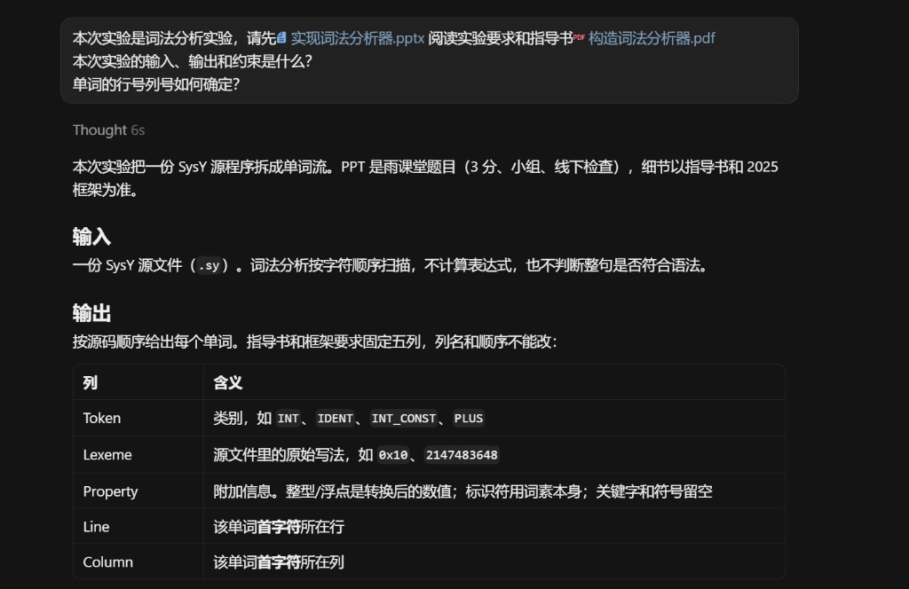
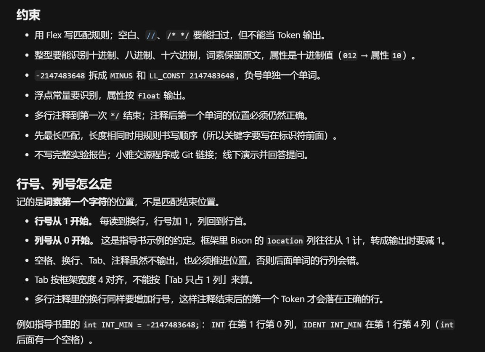
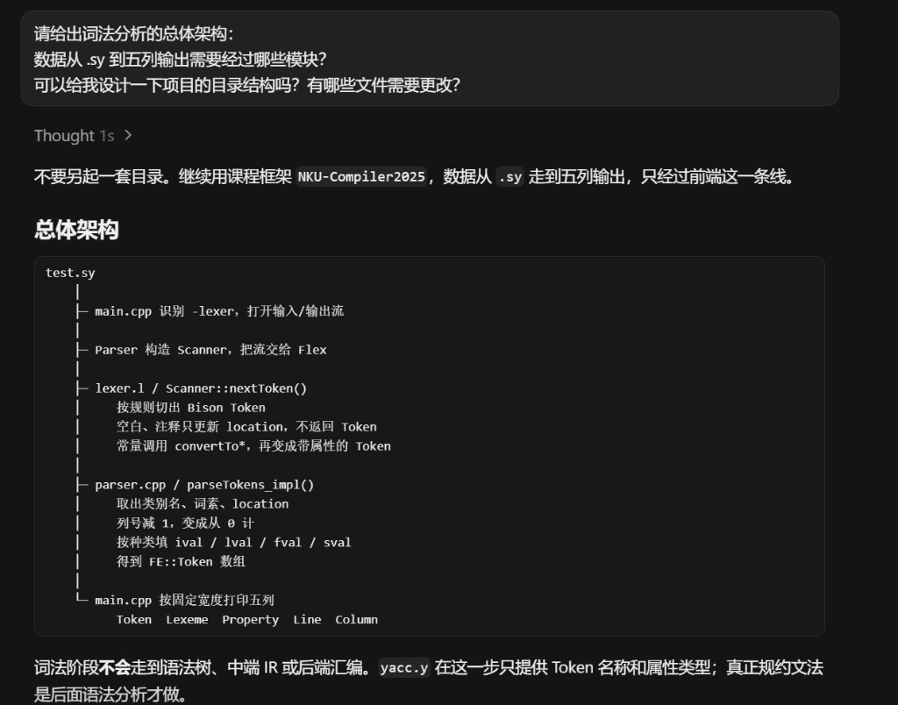
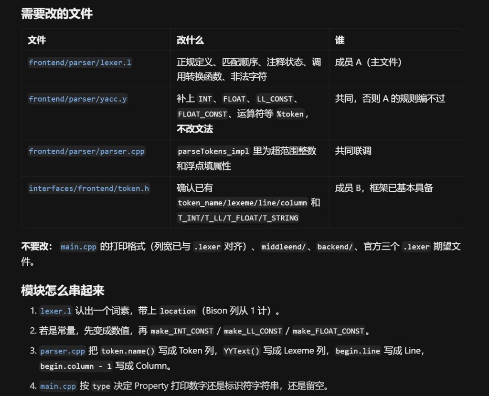
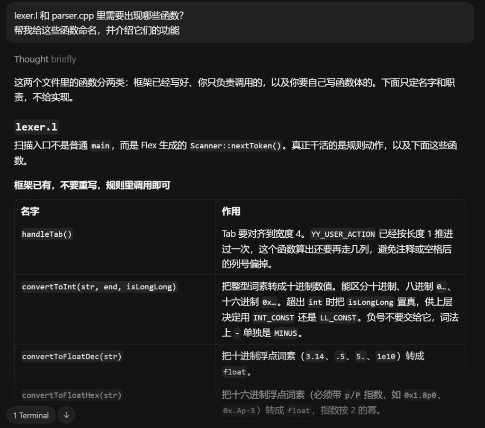
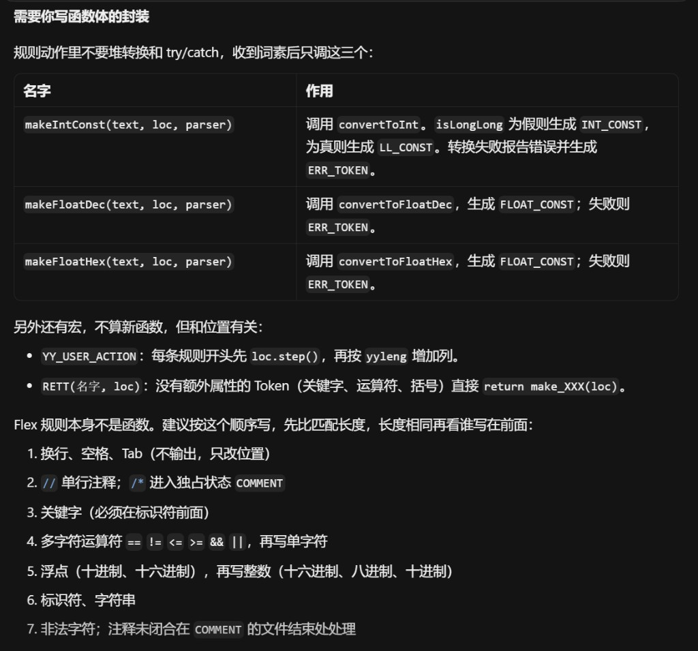
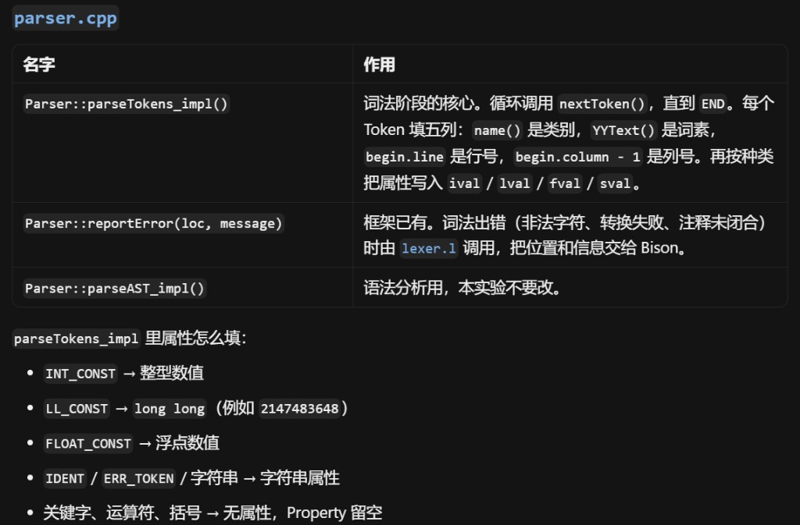
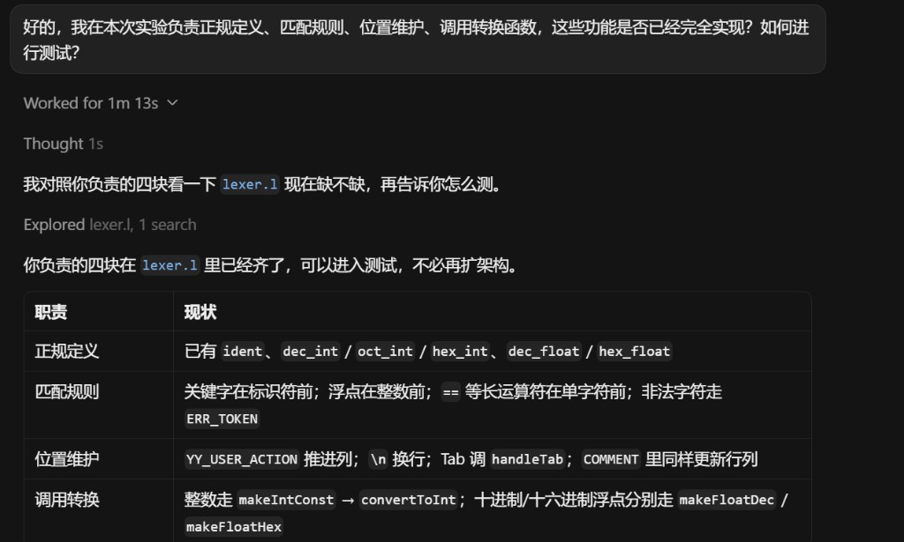
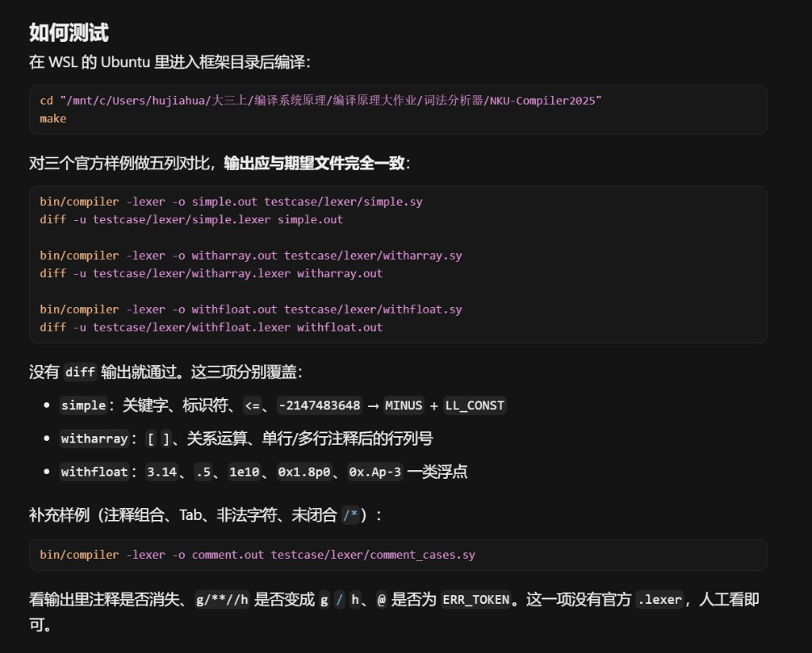

# 词法分析实验 AI 使用记录

AI工具：Cursor。我负责 `lexer.l` 及共同接口联调。

成员A：胡家华2410935

成员B：马禹翔2410933

## 分工原则

- **AI**：总体架构、需要改哪些文件、Token 清单、Flex 规则应分成哪几类、每个函数的职责和调用关系。
- **人工**：函数体内部实现，包括进制转换、行列号计算、Token 封装时的分支与异常处理，以及规则书写顺序的最终核对。

下文各节后附与大模型的对话截图，对应本次实验中实际使用的提问与回答。

## 1. 需求

输入一份 SysY 源文件，按源码顺序输出单词。空白和注释不输出，但要维护后续 Token 的行号、列号。每个 Token 输出类别、词素、属性、行号、列号。

提问：本次实验的输入、输出和约束是什么？单词的行号列号如何确定？





## 2. AI 给出的架构与文件划分

AI 根据课程框架和接口约定，确定仍使用 `NKU-Compiler2025`，不另写独立 Lexer。文件职责如下。


| 文件                            | 分工        | 在架构中的作用                             |
| ----------------------------- | --------- | ----------------------------------- |
| `frontend/parser/lexer.l`     | 成员 A      | 正规定义、匹配规则、位置维护、调用转换函数               |
| `frontend/parser/yacc.y`      | 共同 / 成员 B | 声明 Token 名称和属性类型                    |
| `interfaces/frontend/token.h` | 成员 B      | `FE::Token` 的类别、词素、属性、位置            |
| `frontend/parser/parser.cpp`  | 共同联调      | 把 Bison Token 转成五列输出所需的 `FE::Token` |
| `testcase/lexer/`             | 共同验证      | `simple`、`witharray`、`withfloat`    |


处理流水线由 AI 归纳为：

```text
.sy 源文件
    -> Scanner::nextToken()          // lexer.l 规则
    -> convertTo* / make*            // 词素变数值，再变成 Bison Token
    -> Parser::parseTokens_impl()    // 填 FE::Token
    -> main.cpp -lexer               // 打印五列
```

提问：数据从 .sy 到五列输出需要经过哪些模块？项目目录如何划分、哪些文件需要更改？





## 3. AI 确定的函数与职责

AI 列出需要出现的函数，并约定谁实现函数体。声明、参数和返回值由架构讨论确定；函数体由人工编写或沿用框架实现。


| 函数                                   | 所在位置         | AI 确定的职责                                          | 函数体                                          |
| ------------------------------------ | ------------ | ------------------------------------------------- | -------------------------------------------- |
| `YY_USER_ACTION` / `handleTab()`     | `lexer.l`    | 每个词素先 `step` 再按长度推进列；Tab 宽度 4                     | 框架已有，人工核对后调用                                 |
| `convertToInt(str, end, isLongLong)` | `lexer.l`    | 识别 10/8/16 进制，属性为十进制值；超出 `int` 时置 `isLongLong`    | 框架已有，人工阅读后调用                                 |
| `convertToFloatDec(str)`             | `lexer.l`    | 十进制浮点词素转为 `float`                                 | 框架已有，人工阅读后调用                                 |
| `convertToFloatHex(str)`             | `lexer.l`    | 十六进制浮点词素转为 `float`，指数按 2 的幂                       | 框架已有，人工阅读后调用                                 |
| `makeIntConst(text, loc, parser)`    | `lexer.l`    | 调用 `convertToInt`，在 `INT_CONST` 与 `LL_CONST` 之间选择 | 人工编写函数体                                      |
| `makeFloatDec(text, loc, parser)`    | `lexer.l`    | 调用 `convertToFloatDec`，失败则 `ERR_TOKEN`            | 人工编写函数体                                      |
| `makeFloatHex(text, loc, parser)`    | `lexer.l`    | 调用 `convertToFloatHex`，失败则 `ERR_TOKEN`            | 人工编写函数体                                      |
| `Parser::parseTokens_impl()`         | `parser.cpp` | 按 Token 种类填写 `ival` / `lval` / `fval` / `sval`    | 在原有 switch 中由人工补 `LL_CONST`、`FLOAT_CONST` 两支 |
| `Parser::reportError()`              | `parser.cpp` | 把词法错误位置交给 Bison                                   | 框架已有                                         |


Flex 规则不做成函数，但由 AI 划分类别，规则动作由人工填写：

1. 空白、换行、Tab
2. 单行注释、`COMMENT` 独占状态
3. 关键字（写在标识符之前）
4. 多字符运算符，再写单字符运算符
5. 浮点规则，再写整型规则
6. 标识符、字符串
7. 非法字符与未闭合注释

提问：lexer.l 和 parser.cpp 里需要出现哪些函数？请命名并介绍功能。







## 4. 人工实现时依据的约定

这些判断由指导书和接口约定确定，写进函数体或规则动作时不交给 AI 自行发挥：

- `-2147483648` 拆成 `MINUS` 和 `LL_CONST 2147483648`
- `012` 词素保留原文，属性为 10；`0xA` 同理
- `0x.Ap-3` 必须走浮点规则，不能当成非法字符或整数
- 注释内容不进入 Token 流
- 输出列号使用 `begin.column - 1`

## 5. AI 辅助调试

AI 帮助设计验证步骤，不代替对照期望文件：

```bash
make
bin/compiler -lexer -o simple.out testcase/lexer/simple.sy
diff -u testcase/lexer/simple.lexer simple.out
```

`simple`、`witharray`、`withfloat` 由人工确认五列一致。

提问：正规定义、匹配规则、位置维护、调用转换函数是否已经完全实现？如何测试？



